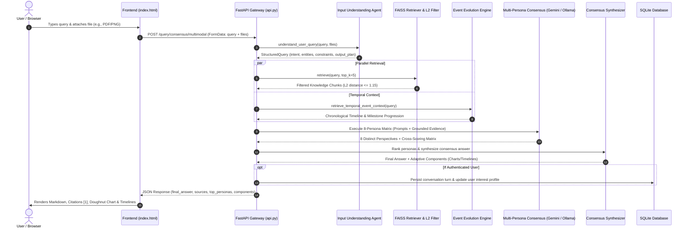
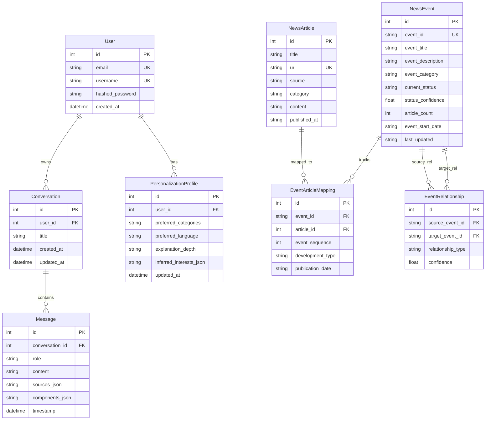

# MultiPersona EvoRAG: System Architecture, Backend Workflow & Technology Stack Guide

---

## 1. Executive Summary & Core Novelties

**MultiPersona EvoRAG** is an advanced, production-grade Retrieval-Augmented Generation (RAG) platform designed for real-time news analysis, multi-perspective intelligence synthesis, and temporal event tracking. 

Unlike conventional RAG systems that retrieve static text chunks and prompt a single generic LLM, MultiPersona EvoRAG implements three architectural breakthroughs:

1. **Multi-Persona Consensus Engine:** Deploys an ensemble of **eight specialized analytical personas** (Analytical-Critical, Empirical-Evidential, Adversarial-Skeptical, Synthesis-Integrative, Domain-Expert, Temporal-Contextual, Risk-Evaluative, and Creative-Lateral) that analyze evidence concurrently, cross-evaluate peer viewpoints through an automated scoring matrix, and dynamically select the top-3 winning perspectives.
2. **Temporal News Event Tracking & Evolution Analysis:** Transforms disparate incoming news articles into persistent, evolving event clusters. Identifies chronological sequences, policy modifications, official responses, corrections, and disputes without overwriting historical records.
3. **Dual-Source User Personalization Agent:** Learns user preferences over time by combining explicit profile selections (onboarding categories, depth preferences) with implicit behavioral queries analyzed with exponential recency decay.

---

## 2. Complete Technology Stack Matrix

| Layer / Feature | Technology / Library | Version / Specifics | Purpose & Implementation Justification |
| :--- | :--- | :--- | :--- |
| **Backend Framework** | **FastAPI** | `^0.110.0` | Asynchronous REST API, OpenAPI docs generation, high concurrency, and dependency injection (`Depends`) for DB sessions and auth. |
| **ASGI Web Server** | **Uvicorn** | `^0.28.0` | High-throughput asynchronous server supporting HTTP/1.1 and WebSockets. |
| **Relational Database** | **SQLite + SQLModel** | `SQLModel ^0.0.16` | Combines SQLAlchemy ORM with Pydantic data validation; zero-configuration, ACID compliant local persistence for users, articles, events, and chats. |
| **Vector Database** | **FAISS (CPU)** | `faiss-cpu ^1.7.4` | Facebook AI Similarity Search; performs sub-millisecond dense vector similarity lookups over indexed news embeddings. |
| **Embedding Model** | **Sentence-Transformers** | `all-MiniLM-L6-v2` (384-d) | Ultra-lightweight, CPU-optimized dense embeddings (384 dimensions); produces vector representations for FAISS indexing and event clustering. |
| **Deep Learning Framework** | **PyTorch** | `torch >= 2.0.0` | Powers the local MiniLM transformer model with fast CPU inference. |
| **LLM Orchestration** | **Google GenAI SDK** | `google-genai` / `gemini-1.5-flash` | Primary structured multimodal LLM engine with Google Search Grounding for live web verification and zero hallucination. |
| **Local LLM Engine** | **Ollama** | Local daemon | Privacy-preserving local LLM pathway (e.g. `llama3`, `mistral`) executing the multi-persona race condition. |
| **Authentication & Security** | **Python-Jose & Passlib** | `bcrypt`, `JWT (HS256)` | Password hashing (bcrypt) and stateless JWT token issuance for user authentication and guest migration. |
| **Multimodal Extraction (PDF)**| **pypdf** | `^4.0.0` | In-memory text extraction from user-uploaded research PDFs and reports. |
| **Multimodal Extraction (DOCX)**| **python-docx** | `^1.1.0` | Parsing paragraph, header, and table contents from Word documents. |
| **Multimodal Extraction (Data)**| **Pandas & OpenPyXL** | `pandas ^2.2.0`, `openpyxl` | Structured parsing, statistical summarization (mean, min, max, count), and previewing of CSV and Excel spreadsheets. |
| **Multimodal Extraction (Image)**| **Pillow (PIL)** | `^10.2.0` | Validates image dimensions, headers, formats (PNG, JPG), and extracts metadata for multimodal analysis. |
| **News RSS Scraping** | **Feedparser & Requests** | `feedparser ^6.0.10` | Automated ingestion of RSS feeds across 18 major global categories (BBC, Reuters, TechCrunch, Verge, etc.). |
| **Frontend Framework** | **Vanilla HTML5, Modern CSS3, ES6+ JS** | Pure native web | Ultra-fast load times, zero build overhead, native DOM manipulation, dark-theme styling, and responsive layout. |
| **Data Visualizations** | **Chart.js** | `^4.4.0` CDN | Interactive Doughnut charts for persona consensus distribution, multi-query trend line charts, and adaptive visual cards. |
| **Voice & Speech Synthesis** | **Web Speech API & Audio API** | Native browser | In-browser speech recognition (speech-to-text) and speech synthesis (text-to-speech) for hands-free analysis. |

---

## 3. High-Level Architecture Diagram

```mermaid
flowchart TD
    subgraph Client ["Frontend Client (Vanilla JS / CSS3 / HTML5)"]
        UI["Modern Web Interface (index.html)"]
        Chat["ChatGPT-Style Multi-Turn Thread"]
        Feed["Personalized News Discovery & Tabs"]
        EventsUI["Tracked News Events & Timeline Modal"]
        Composer["Multimodal Composer (Text, Voice, PDF, Image, CSV)"]
        ChartUI["Chart.js Dynamic Persona Doughnut Visualizer"]
    end

    subgraph API_Gateway ["FastAPI Routing Layer (api.py)"]
        Q_End["/query/consensus (Text)"]
        M_End["/query/consensus/multimodal (Files + Form)"]
        N_End["/news/homepage & /news/autocomplete"]
        E_End["/events & /events/{id}/timeline"]
        C_End["/conversations & /conversations/{id}/messages"]
        A_End["/auth/signup & /auth/login"]
        P_End["/personalization/profile & /preferences"]
    end

    subgraph Core_Pipeline ["EvoRAG Orchestration Core (pipeline.py)"]
        IUA["Input Understanding Agent (input_understanding_agent.py)"]
        UPA["User Personalization Agent (personalization_agent.py)"]
        RP["Adaptive Response Planner (response_planner.py)"]
        SYN["Consensus & Synthesis Engine (synthesis.py)"]
    end

    subgraph Retrieval_Layer ["Retrieval & Data Engine (retriever.py)"]
        FAISS_DB[("FAISS Vector Index (139+ Chunks, 384-d)")]
        MiniLM["Sentence-Transformers (all-MiniLM-L6-v2)"]
        TEM_RET["Temporal Event Context Retriever"]
        L2_Filter["L2 Distance Score Filter (threshold <= 1.15)"]
    end

    subgraph Temporal_Event_System ["Temporal News Event Tracking (event_evolution_service.py)"]
        TwoStage["Two-Stage Clustering (event_clustering_service.py)"]
        DevClassifier["Development Stage Classifier (11 Types)"]
        TimelineGen["Chronological Timeline Synthesizer"]
    end

    subgraph Persona_Consensus ["8-Persona Consensus Matrix (personas.py)"]
        P1["Analytical-Critical"]
        P2["Empirical-Evidential"]
        P3["Adversarial-Skeptical"]
        P4["Synthesis-Integrative"]
        P5["Domain-Expert"]
        P6["Temporal-Contextual"]
        P7["Risk-Evaluative"]
        P8["Creative-Lateral"]
        Matrix["Cross-Evaluation Scoring Matrix (80% Peer + 20% Personal)"]
    end

    subgraph LLM_Engines ["Dual LLM Execution Layer"]
        Gemini["Google Gemini 1.5 Flash (Google Search Grounding)"]
        Ollama["Local Ollama Daemon (Llama3/Mistral fallback)"]
    end

    subgraph Storage ["Persistent SQLite DB (database.db)"]
        T_User[("User & Profiles")]
        T_News[("NewsArticle Storage")]
        T_Events[("NewsEvent & Mappings")]
        T_Chats[("Conversations & Messages")]
    end

    %% Wiring connections
    UI --> API_Gateway
    Composer --> M_End
    Chat --> Q_End
    Feed --> N_End
    EventsUI --> E_End

    Q_End --> Core_Pipeline
    M_End --> Core_Pipeline
    Core_Pipeline --> IUA
    IUA --> UPA
    IUA --> Retrieval_Layer
    Retrieval_Layer --> MiniLM
    MiniLM --> FAISS_DB
    Retrieval_Layer --> L2_Filter
    Retrieval_Layer --> TEM_RET
    TEM_RET --> Temporal_Event_System

    Core_Pipeline --> Persona_Consensus
    Persona_Consensus --> LLM_Engines
    LLM_Engines --> Matrix
    Matrix --> SYN
    SYN --> Core_Pipeline

    API_Gateway --> Storage
    Temporal_Event_System --> T_Events
```



---

## 4. Backend Components: Detailed Deep Dive

### 4.1. Input Understanding & Query Routing Agent (`input_understanding_agent.py`)
* **Role:** Analyzes the raw prompt before retrieval or LLM execution to understand intent, constraints, and required output modalities.
* **Mechanism:**
  - Extracts **Named Entities** (Organizations, People, Products, Locations) using regex patterns and domain heuristics.
  - Detects **Entity Relationships** (e.g. *Nvidia acquires Run:ai* $\rightarrow$ `acquisition`).
  - Identifies **Temporal Scope**: Distinguishes between historical queries (*"history of AI"*) and latest-news queries (*"recent breakthroughs"*), setting `requires_latest_information = True`.
  - Classifies **Intent**: Labels queries as `factual`, `comparative`, `temporal_evolution`, `numerical_analysis`, or `exploratory`.
  - Determines **Adaptive UI Output**: Decides whether the response should include a `comparison_table`, a `line_chart`, a `pie_chart`, an `event_timeline`, or a `numerical_summary`.

### 4.2. Dual-Source User Personalization Agent (`personalization_agent.py`)
* **Role:** Builds and dynamically updates a profile for each authenticated user to tailor news discovery and persona selection.
* **Two Information Sources:**
  1. **Source A (Explicit):** Configured via the Preferences page (`/preferences`). Captures preferred news categories, explanation length, preferred language, and preferred analytical perspectives.
  2. **Source B (Implicit):** Inferred automatically from multi-turn chat history. Analyzes recurring keywords and topics across previous questions.
* **Exponential Recency Decay:** Applies a temporal decay factor $\lambda$:
  $$\text{Weight} = e^{-\lambda \cdot \Delta t}$$
  Ensures that topics asked recently receive high relevance, while temporary curiosities naturally fade.
* **Persona Influence:** In the final persona selection, 20% of the voting weight is allocated to the user's personalization profile, ensuring that a user who prefers deep technical detail consistently sees the *Domain-Expert* persona in the top-3.

### 4.3. FAISS Vector Retrieval & Semantic Search (`retriever.py`, `embedder.py`)
* **Role:** Fast semantic search over indexed news articles and documents.
* **Mechanism:**
  - Uses `all-MiniLM-L6-v2` to map text into a 384-dimensional vector space.
  - Queries `faiss.IndexFlatL2` to retrieve the top candidate chunks.
  - **Deduplication:** Strips duplicate paragraphs from the same article or news source.
  - **L2 Distance Relevance Filtering:** Drops any retrieved chunk with an L2 distance score $> 1.30$ (or $> 1.15$ when multimodal attachments exist), ensuring that unrelated background articles never contaminate the analysis.

### 4.4. Temporal News Event Tracking & Evolution Engine (`event_clustering_service.py`, `event_evolution_service.py`, `event_api.py`)
* **Role:** Connects independent news articles into chronological, evolving event clusters.
* **Two-Stage Event Clustering:**
  - **Stage 1 (Candidate Generation):** Computes cosine similarity between new article embeddings and active event cluster centroids. Filters out events outside the publication time window.
  - **Stage 2 (Entity & Location Verification):** Verifies named entities (actors, organizations) and locations. Differentiates broad topics from distinct events (e.g., *US AI Executive Order* vs. *EU AI Act* are kept in separate event clusters despite sharing the topic "AI Regulation").
* **Development Stage Classification:** Automatically classifies each article into one of 11 development types:
  `Initial announcement`, `Policy modification`, `Official response`, `Legal action`, `Investigation`, `Resolution`, `Correction`, `Clarification`, `Conflict or controversy`, `Executive action`, or `Update`.
* **Non-Destructive Update Principle:** Historical articles and earlier turning points are permanently preserved in `EventArticleMapping`. Subsequent developments are appended chronologically.

### 4.5. 8-Persona Consensus & Peer Evaluation Engine (`pipeline.py`, `personas.py`, `synthesis.py`)
* **Role:** Replaces single-LLM bias with an ensemble of 8 specialized viewpoints.
* **The 8 Personas:**
  1. **Analytical-Critical:** Deconstructs claims, logic, and mechanistic structures.
  2. **Empirical-Evidential:** Demands hard numbers, verified data, and direct citations.
  3. **Adversarial-Skeptical:** Formulates substantive counter-arguments and alternative viewpoints.
  4. **Synthesis-Integrative:** Connects disparate themes into a unified narrative.
  5. **Domain-Expert:** Provides specialized technical depth and industry terminology.
  6. **Temporal-Contextual:** Frames issues within chronological trajectories.
  7. **Risk-Evaluative:** Assesses strategic vulnerabilities, threats, and failure modes.
  8. **Creative-Lateral:** Explores novel framings and interdisciplinary connections.
* **Consensus Scoring Matrix:**
  Each persona reviews peer responses and assigns a score from 1 to 10. The system combines:
  $$\text{Final Score} = (0.80 \times \text{Peer Evaluation Score}) + (0.20 \times \text{User Personalization Alignment})$$
* **Synthesis:** The top 3 ranked personas are merged into a single, authoritative final answer that preserves inline evidence citations `[1]`, `[2]`, `[3]`.
* **Sanitization:** An automated post-processing filter (`strip_unwanted_limitation_sections`) cleanses the output of trailing meta-disclaimers or system self-critiques.

### 4.6. Multimodal File Extraction Engine (`file_processor.py`)
* **Role:** Extracts and structures data from uploaded user files in real time.
* **Supported Formats:**
  - **PDF (`pypdf`):** Strips page metadata, extracts raw text, detects tables.
  - **DOCX (`python-docx`):** Traverses paragraph trees and structured Word tables.
  - **CSV / XLSX (`pandas`, `openpyxl`):** Reads tabular data, calculates statistical summaries (mean, min, max, count per numeric column), and converts sample rows into JSON.
  - **Images (`Pillow`):** Checks image validity and prepares high-resolution byte buffers for visual inspection.
* **Caching:** Files are hashed using SHA-256 and stored in an LRU memory cache, preventing redundant extractions.

### 4.7. News Ingestion & Smart Autocomplete (`news_service.py`, `autocomplete_service.py`)
* **Role:** Ingests live news feeds, manages personalized homepages, and powers search autocomplete.
* **News Ingestion:** Periodically scrapes RSS feeds from verified international and national news outlets across 18 domains.
* **Smart Autocomplete:**
  - Employs a Trie / Prefix-tree combined with Levenshtein fuzzy matching.
  - Boosts trending keywords, recent headlines, and user-preferred categories.
  - Provides instant search suggestions as the user types in the query composer.

---

## 5. End-to-End Query Execution Lifecycle



---

## 6. Frontend Architecture & Interactive UI Systems

The frontend is implemented in vanilla HTML5, CSS3, and ES6+ JavaScript, requiring no heavy client-side build steps (e.g. Webpack or Vite), ensuring instant rendering:

1. **Guest Mode vs. Authenticated Mode:**
   - **Guest Users:** Can browse news, explore tracked events, use the EvoRAG chat assistant, and attach files without an account. Chats are temporarily saved in `sessionStorage`.
   - **Registered Users:** Enjoy permanent conversation history, mandatory onboarding preferences, and dynamic personalized news feeds.
2. **Tracked News Events & Interactive Timeline Modal:**
   - Displays real-world event cards with status pills (`Emerging`, `Developing`, `Ongoing`, `Resolved`).
   - Clicking any card opens a modal displaying the **Chronological Milestones**, **Turn-by-Turn Developments**, and source links.
   - Includes an **"⚡ Analyze this Event"** button that pre-fills and executes a deep temporal analysis in the chat interface.
3. **Dynamic Persona Doughnut Chart:**
   - Built with **Chart.js**.
   - Shows the active consensus weights and contribution percentages of each persona for the current query.
   - Highlights the **Top-3 Consensus Winners** with star badges (`★`).
   - Features a toggle button to switch between the active **Query Breakdown** and the longitudinal **Multi-Query Trend**.
4. **Adaptive Multimodal Composer:**
   - Supports drag-and-drop file uploading and paperclip attachment.
   - Provides instant pill previews with file size and format badges.
   - Integrated with Web Speech API for voice recording and audio playback of synthesized responses.

---

## 7. Database Models & Relational Schema



---

## 8. Automated Test & Verification Suites

The repository contains automated test suites verifying every layer of the architecture:

1. **`test_temporal_event_tracking.py` (14 Scenarios):**
   - Validates event clustering, entity verification, 11 development classifications, non-destructive timeline generation, conflict preservation, and API endpoints (100% pass rate).
2. **`test_phase7_multimodal.py` (14 Scenarios):**
   - Validates plain text queries, voice queries, PDF parsing, CSV numerical analysis, multiple image comparisons, and fallback routing.
3. **`test_user_personalization.py`:**
   - Validates explicit preference extraction, implicit chat inference, exponential decay, and persona weight shifting.
4. **`test_guest_news_autocomplete.py`:**
   - Tests unauthenticated guest exploration, general news feed rendering, mandatory onboarding redirection, and fuzzy search autocomplete.

---

## 9. Running and Testing the Platform

### Starting the Server
Run the application from the repository root:
```bash
python -m uvicorn api:app --host 0.0.0.0 --port 8000
```

### Accessing Endpoints
* **Frontend Web Interface:** [http://localhost:8000/static/index.html](http://localhost:8000/static/index.html)
* **Interactive API Documentation (Swagger):** [http://localhost:8000/docs](http://localhost:8000/docs)
* **Alternative API Schema (ReDoc):** [http://localhost:8000/redoc](http://localhost:8000/redoc)
